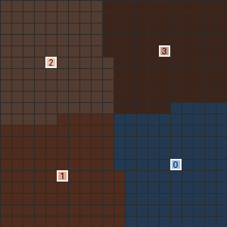
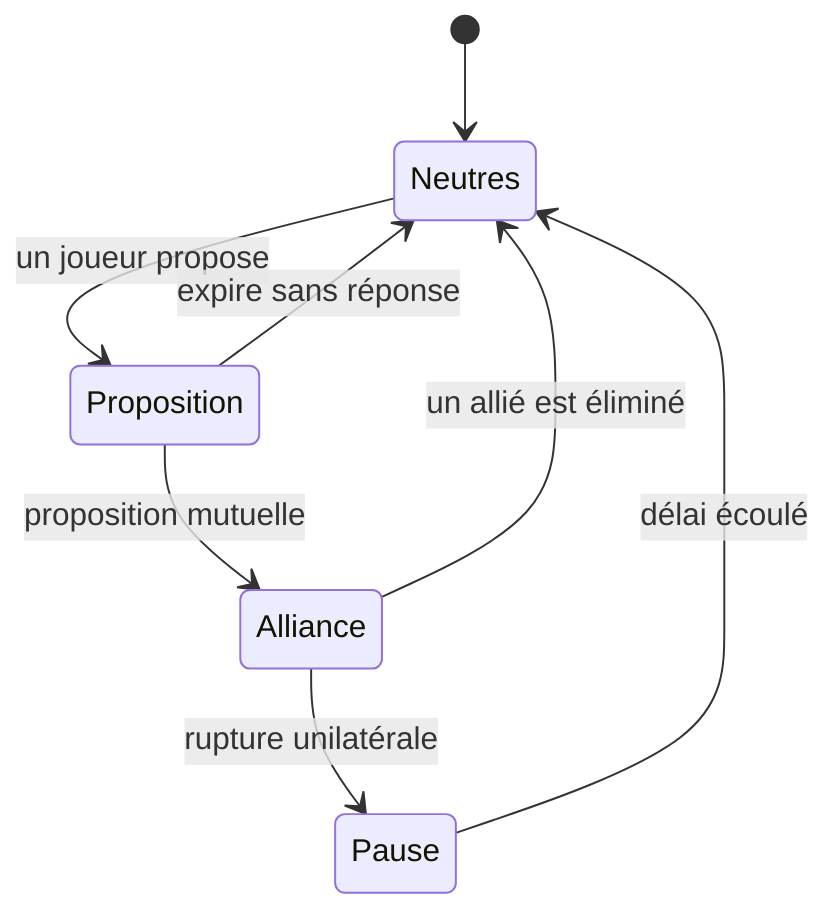
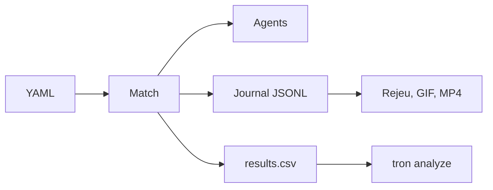
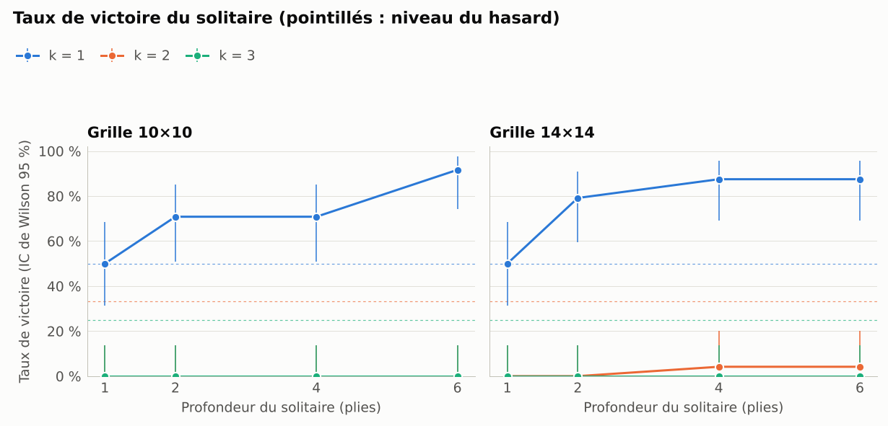

<div align="center">

# 🏍️ Tron : multi-joueurs & coalitions

### Et si trois joueurs s'alliaient contre un seul ? Et si l'un d'eux trahissait ?

Un laboratoire de jeu pour la recherche multi-agents : des motos lumineuses, des algorithmes qui s'affrontent, s'allient… et se trahissent.


[Démarrage](#-démarrage-en-3-minutes) · [Agents](#-le-bestiaire-des-agents) · [Arènes](#-les-arènes) · [Diplomatie](#-alliances-ruptures-trahisons) · [Expériences](#-ce-que-disent-déjà-les-expériences) · [Votre agent](#-créez-votre-propre-joueur) · [Documentation](#-documentation)

</div>

---

## Le principe

Dans Tron, chaque joueur laisse derrière lui un mur de lumière. Qui s'enferme ou percute un mur est éliminé ; en mode classique, la dernière équipe en piste l'emporte.

Ici, **de 2 à 8 programmes** s'affrontent tour par tour sur une grille de 5 × 5 à 100 × 100. Aucun joueur humain, aucun hasard caché : des algorithmes de recherche, des préférences sociales et beaucoup de murs.

Dès que l'on autorise les équipes, les questions deviennent passionnantes :

- un solitaire parfaitement calculateur peut-il tenir tête à une coalition de trois joueurs ?
- jusqu'où la profondeur de recherche compense-t-elle le nombre ?
- combien de temps dure une alliance, et que vaut une trahison ?

## Ce que vous y trouverez

| | |
|---|---|
| 🧠 **9 agents** | du hasard à MCTS, en passant par un agent qui profile ses adversaires |
| 🤝 **Coalitions** | statiques, ou dynamiques avec diplomatie : propositions, alliances, ruptures, trahisons |
| 🗺️ **5 modes de jeu** | classique, survie individuelle, contrôle de zone, obstacles dynamiques, équipes asymétriques |
| 🎬 **Visualisation** | fenêtre Arcade en temps réel et en rejeu (avant / arrière), explication des décisions, exports GIF / MP4 |
| 🔬 **Campagnes d'expériences** | reproductibles, parallèles, reprenables, avec analyse statistique intégrée |
| 💾 **Sauvegarde exacte** | arrêtez une partie, reprenez-la plus tard, coup pour coup |
| 🤖 **Apprentissage** | environnement de type Gym et politique linéaire entraînable avec NumPy seul |
| 🧩 **Extensible** | API Python publique, agents et heuristiques ajoutés par *entry points* |

## 🚀 Démarrage en 3 minutes

> [!NOTE]
> La pile cible est **Python 3.14** et **Arcade 3.3.3**. NumPy et Numba servent au calcul, matplotlib et imageio aux figures et aux exports, pandas, SciPy et statsmodels à l'analyse.

```bash
# 1. Installer
uv sync --extra dev                  # crée .venv avec Python 3.14 (fichier .python-version)
source .venv/bin/activate            # ou préfixez chaque commande par « uv run »

# 2. Un Paranoid contre une coalition de 3 : fenêtre Arcade en temps réel
tron play configs/games/solo_vs_3_20x20.yaml

# 3. Dix parties sans fenêtre, puis rejeu de la première
tron play configs/games/ffa4_20x20.yaml --no-gui --games 10 --out results/ffa4
tron replay results/ffa4/game_0000.jsonl
```

<div align="center">
  
  <br>
  <sub>Le solitaire (bleu) contre une coalition de trois joueurs, territoires de Voronoi en surcouche.</sub>
</div>

<details>
<summary>Autre installation, Numba et apprentissage</summary>

```bash
python3.14 -m venv .venv && .venv/bin/pip install -e ".[dev]"
```

Numba compile les noyaux au premier appel et les met en cache. Pour déboguer en Python pur : `NUMBA_DISABLE_JIT=1` (même résultat, plus lentement). L'extra `learning` ajoute Gymnasium pour l'adaptateur facultatif de l'environnement d'apprentissage.

</details>

### 🕹️ Aux commandes

| Touche | Action | Touche | Action |
|---|---|---|---|
| <kbd>Espace</kbd> | pause / lecture | <kbd>V</kbd> | territoires de Voronoi |
| <kbd>→</kbd> <kbd>←</kbd> | demi-coup suivant / précédent (retour arrière en rejeu) | <kbd>D</kbd> | panneau de décision de l'agent |
| <kbd>↑</kbd> <kbd>↓</kbd> | vitesse | <kbd>N</kbd> | nouvelle partie |
| <kbd>Début</kbd> <kbd>Fin</kbd> | début / fin du rejeu | <kbd>S</kbd> | capture d'écran |
| <kbd>Échap</kbd> <kbd>Q</kbd> | quitter | | |

<details>
<summary>Toutes les commandes <code>tron</code></summary>

```bash
tron play configs/games/solo_vs_3_20x20.yaml                                                    # fenêtre Arcade, temps réel
tron play configs/games/ffa4_20x20.yaml --no-gui --games 10 --out results/ffa4
tron replay results/ffa4/game_0000.jsonl                                                        # rejeu avant / arrière
tron replay results/ffa4/game_0000.jsonl --gif partie.gif --voronoi                             # export
tron compare results/ffa4/game_0000.jsonl results/ffa4/game_0001.jsonl                          # deux rejeux synchronisés
tron play configs/games/duel_20x20.yaml --no-gui --checkpoint sauvegarde.json --stop-after 40
tron resume-checkpoint sauvegarde.json                                                          # reprise exacte
tron run configs/plans/pilote.yaml --workers 8                                                  # campagne (reprise automatique)
tron run configs/plans/heuristic_comparison.yaml --pilot                                        # variante pilote d'un plan
tron analyze results/pilote/results.csv                                                         # tableaux, tests, figures
tron bench --suite                                                                              # mesures par composant
tron train configs/training/linear_duel.yaml --out models/linear_duel                           # apprentissage
tron config validate configs/games/*.yaml                                                       # validation des YAML
tron config template campaign --out mon_plan.yaml                                               # modèle commenté
tron agents list                                                                                # agents et paramètres
tron heuristics list
tron plugins list                                                                               # extensions installées
```

</details>

## Le bestiaire des agents

Chaque joueur est piloté par un agent, choisi dans le YAML avec la clé `agent`. `tron agents list` affiche leurs paramètres.

| | Agent | Son caractère |
|---|---|---|
| 🎲 | `random` | tire un coup sûr au hasard |
| 🍬 | `greedy` | ne voit qu'un coup d'avance et croque la plus grosse part de territoire |
| ⚖️ | `negamax` | l'alpha-bêta à deux joueurs, la référence du duel |
| 😰 | `paranoid` | persuadé que tout le monde est ligué contre lui : ses adversaires forment un seul camp |
| 🐺 | `maxn` | chacun pour soi, chaque joueur maximise son propre score |
| 🕊️ | `social` | le diplomate : une matrice de préférences pondère le sort de ses partenaires (profils `team`, `paranoid`, `maxn`, `dynamic_team`…) |
| 🎰 | `mcts` | le parieur : simule des centaines de parties pour juger chaque coup |
| 🕵️ | `adaptive` | le profileur : estime le style de ses adversaires à partir de leurs coups et ajuste ses poids |
| 🎓 | `learned` | l'élève : une politique linéaire apprise par entraînement |

Pour juger une position, les agents s'appuient sur des **heuristiques** : `voronoi` (qui atteint chaque case en premier), `composite` (territoire, mobilité, sorties, marge, passages) et `zone` (contrôle de zone).

## 🧭 Les arènes

Les variantes se décrivent dans la clé `rules` du YAML : aucune règle n'est codée dans les agents. Chaque ligne se lance avec `tron play <fichier>`.

| Arène | Fichier | Ce qui se passe |
|---|---|---|
| ⚔️ Duel | `configs/games/duel_20x20.yaml` | Paranoid contre MaxN sur 20 × 20 |
| 🥊 Chacun pour soi | `configs/games/ffa4_20x20.yaml` | quatre joueurs, un agent de chaque famille |
| 🛡️ Équipes 2 contre 2 | `configs/games/teams_2v2_20x20.yaml` | équipe coordonnée (SOS) contre équipe individualiste (MaxN) |
| 🌍 Mêlée à huit | `configs/games/melee_8_30x30.yaml` | huit joueurs, quatre équipes de deux, grille 30 × 30 |
| 🏆 Survie individuelle | `configs/games/survival_individual_12x12.yaml` | même les coéquipiers s'affrontent : le dernier survivant gagne |
| 📍 Contrôle de zone | `configs/games/zone_control_16x16.yaml` | un point par tour pour l'équipe qui tient seule une zone |
| 🧱 Obstacles dynamiques | `configs/games/obstacles_14x14.yaml` | des murs apparaissent en cours de partie |
| 🏹 Chasseurs et proie | `configs/games/hunters_prey_12x12.yaml` | la proie gagne en survivant 32 tours, les chasseurs doivent l'éliminer avant |
| 🎰 Duel MCTS | `configs/games/mcts_duel_12x12.yaml` | MCTS contre Paranoid, démonstration rapide |
| 🤝 Diplomatie à quatre | `configs/games/diplomacy_4p_20x20.yaml` | alliances tactiques et trahisons |

Une partie se décrit en quelques lignes :

```yaml
name: solo_vs_3
grid: 20                                         # ou [largeur, hauteur], ou {width, height}
seed: 3                                          # tout l'aléa dérive de cette graine
first_player: 0
placement: {mode: regular, radius: 0.35, rotate: true}
heuristic: {name: voronoi, tie: order}           # voronoi | composite | zone
players:
  - {name: solo, team: solo, agent: paranoid, depth: 8}
  - {name: c1, team: coalition, agent: social, depth: 3, profile: team, alpha: 1.0}
  - {name: c2, team: coalition, agent: social, depth: 3, profile: team, alpha: 1.0}
  - {name: c3, team: coalition, agent: social, depth: 3, profile: team, alpha: 1.0}
```

Un joueur sans `team` forme sa propre équipe ; les autres clés du joueur sont transmises à l'agent et `defaults` s'applique à tous les joueurs. `tron config template game|teams|dynamic|zone|campaign|training` crée un point de départ commenté, `tron config validate` le vérifie et `tron config show` affiche sa forme normalisée.

## 🤝 Alliances, ruptures, trahisons

En mode diplomatie, les équipes de la configuration restent **permanentes** (elles décident de la victoire), mais les agents peuvent nouer des **alliances tactiques** qui changent leurs préférences. Une action diplomatique ne coûte aucun coup.



- **Trahison** : rompre une alliance sans que l'autre ne l'ait jamais fait en premier. La confiance de p envers q vaut `1 / (1 + trahisons de q envers p)`.
- **Pas de pacte éternel** : une alliance n'empêche jamais de gagner contre son allié.
- **Politique « contre le meneur »** : l'équipe la plus grande en territoire devient la cible, et les autres s'allient contre elle.

```bash
tron play configs/games/diplomacy_4p_20x20.yaml --no-gui --out results/dipl
```

> [!NOTE]
> Dans cette version, les alliances évoluent entre les décisions réelles : les agents ne simulent pas les propositions ou ruptures futures dans leur arbre de recherche. Limites détaillées dans [`docs/coalitions-dynamiques.md`](docs/coalitions-dynamiques.md).

## Ce que disent déjà les expériences

Une chaîne complète transforme un plan YAML en tableaux, tests statistiques et figures :



Le **plan pilote** (`configs/plans/pilote.yaml`) a joué **1 152 parties en une minute sur deux cœurs** : un Paranoid de profondeur 1 à 6 contre une coalition coordonnée de `k` joueurs, sur des grilles 10 × 10 et 14 × 14.

<div align="center">
  
</div>

| Taille de la coalition | Victoires du solitaire (384 parties chacune) |
|---|---|
| `k = 1` (un duel) | 271 (≈ 71 %) |
| `k = 2` | 11 (≈ 3 %) |
| `k = 3` | 0 |

Autres enseignements : les gains de profondeur diminuent en duel (significatifs de 1 à 2 puis de 2 à 4 plies, pas de 4 à 6), et le coût de calcul est multiplié par au plus 3 à chaque pli supplémentaire.

> [!IMPORTANT]
> C'est un pilote, avec 24 parties par condition : il valide la chaîne et calibre la campagne, il ne permet pas de conclure. Les autres plans de `configs/plans/` sont prêts à être lancés, à vous de jouer.

<details>
<summary>Les plans d'expériences fournis</summary>

| Plan | Question posée |
|---|---|
| `pilote` | version réduite de l'étude A, pour valider la chaîne |
| `etude_a` | un Paranoid contre une coalition de k joueurs (360 conditions) |
| `etude_a_cooperation` | coalition coordonnée ou individualiste, Paranoid ou MaxN pour le solitaire |
| `etude_b` | équipes contre équipes, profondeur de T0 contre celle de T1 |
| `heuristic_comparison` | Voronoi contre composite pour le solitaire |
| `ablation` | heuristique composite, une composante mise à zéro à la fois |
| `mcts_comparison` | MCTS face à MaxN, Paranoid, Social et Greedy |
| `mcts_simulations` | taux de victoire de MCTS selon le nombre de simulations |
| `adaptive_agents` | agent fixe contre agent adaptatif face à chaque profil d'adversaire |
| `dynamic_alliances` | diplomatie inactive ou active, durée de vie des propositions, poids d'alliance |

```bash
tron run configs/plans/mcts_simulations.yaml --pilot      # variante rapide
tron run configs/plans/etude_a.yaml --workers 8           # campagne complète, reprise automatique
tron analyze results/etude_a/results.csv                  # tableaux, tests, figures
```

Les figures du pilote et les commandes pour les reproduire sont dans [`docs/exemples/`](docs/exemples/README.md).

</details>

## 🧩 Créez votre propre joueur

Un agent tient en quelques lignes. Celui-ci joue le coup qui laisse le plus de cases libres autour de sa tête :

```python
from tron.agents.base import Agent, SearchStats, register_agent

@register_agent("prudent")
class PrudentAgent(Agent):
    def __init__(self, player, config, *, marge: int = 1, **kwargs):
        super().__init__(player, config, **kwargs)
        self.marge = marge

    def _decide(self, state, moves):
        scores = {}
        for m in moves:
            state.apply(m)
            scores[m] = len(state.legal_moves(self.player))
            state.undo()                       # l'état reçu doit être restauré
        best = max(scores.values())
        ties = [m for m in moves if scores[m] == best]
        move = self.pick(ties)                 # départage reproductible
        return move, SearchStats(nodes=len(moves), depth=1, ties=len(ties), engine=self.name)
```

```yaml
players:
  - {name: p0, agent: prudent, marge: 2}
```

Un exemple exécutable est dans `examples/agent_personnalise.py`. Pour distribuer l'agent dans un paquet séparé, voir `examples/plugin_exemple/`.

### 🐍 API Python

```python
from tron.api import load_game_config, run_game, run_games, load_replay

result = run_game(load_game_config("configs/games/duel_20x20.yaml"), seed=3, log="partie.jsonl")
results = run_games("configs/games/teams_2v2_20x20.yaml", games=20, workers=4)
final = load_replay("partie.jsonl").final_state()
```

Exemples exécutables dans `examples/` : partie unique, campagne, rejeu, agent personnalisé, extension installable.

### 🤖 Apprentissage

```bash
tron train configs/training/linear_duel.yaml --out models/linear_duel
tron evaluate-model models/linear_duel/model.json configs/games/mcts_duel_12x12.yaml --games 40
```

## 📚 Documentation

| Thème | Documents |
|---|---|
| **Comprendre** | [`architecture`](docs/architecture.md) : couches, flux, schémas · [`algorithmes`](docs/algorithmes.md) : valeurs, moteurs, élagages, réduction à deux camps, MCTS · [`agents`](docs/agents.md) : contrat d'un agent, agents fournis, modèle d'adversaires · [`heuristiques`](docs/heuristiques.md) : contrat `shares`, Voronoi, composite | [`api`](docs/api.md) : API publique |
| **Jouer** | [`modes-de-jeu`](docs/modes-de-jeu.md) : survie, contrôle de zone, obstacles, équipes asymétriques · [`coalitions-dynamiques`](docs/coalitions-dynamiques.md) : protocole diplomatique et limites · [`sauvegardes`](docs/sauvegardes.md) : sauvegarde et reprise · [`visualisation`](docs/visualisation.md) : rejeu, explications, validation de la fenêtre |
| **Expérimenter** | [`experiences`](docs/experiences.md) : créer un plan, lancer, reprendre, analyser · [`metriques`](docs/metriques.md) : métriques de coopération · [`exemples`](docs/exemples/README.md) : résultats du pilote · [`learning`](docs/learning.md) : environnement d'apprentissage et entraînement |
| **Fiabilité** | [`performance`](docs/performance.md) : mesures, profilage, Numba, tests de charge |

## Qualité et reproductibilité

> [!IMPORTANT]
> À configuration et graine identiques, une partie est identique **coup pour coup**, quel que soit l'ordonnancement des processus. Tout l'aléa passe par `tron.core.rng`, et les temps de compilation JIT sont exclus des mesures.

La limite de temps de réflexion facultative (`time_limit`) rend les parties dépendantes de la machine : désactivée par défaut, elle ne doit pas servir aux campagnes.

```bash
pytest                                       # suite complète (tests de charge exclus)
NUMBA_DISABLE_JIT=1 pytest                   # mêmes tests en Python pur
pytest -m load                               # tests de charge
pytest --cov=tron.core --cov=tron.eval --cov=tron.agents --cov-fail-under=80
ruff check src tests && ruff format --check src tests
mypy src
```

Les mêmes vérifications sont prévues en intégration continue (`.github/workflows/ci.yml`).
