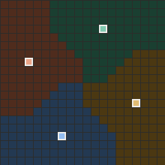

# Tron multi-joueur et coalitions

Simulateur de Tron sans joueur humain (2 à 8 joueurs, grille de 5 × 5 à 100 × 100, tour par tour) pour étudier la recherche multi-agents et les coalitions :

- agents : aléatoire, glouton, Negamax, Paranoid, MaxN, préférences sociales (SOS), MCTS, agent adaptatif à modèle d'adversaires, politique apprise ;
- heuristiques : Voronoi, composite (territoire, mobilité, sorties, marge, passages), contrôle de zone ;
- coalitions statiques ou dynamiques (diplomatie tactique : propositions, alliances, ruptures, trahisons) ;
- modes de jeu : classique, survie individuelle, contrôle de zone, obstacles dynamiques, équipes asymétriques ;
- visualisation Arcade en temps réel et en rejeu, explication des décisions, exports GIF / MP4 ;
- campagnes d'expériences reproductibles et parallèles, sauvegarde et reprise de partie, analyse statistique ;
- environnement d'apprentissage par renforcement, API Python publique, extensions par *entry points*.

<p align="center">
  
</p>

La pile cible est **Python 3.14** et **Arcade 3.3.3**. NumPy et Numba servent au calcul, matplotlib et imageio aux figures et aux exports, pandas, SciPy et statsmodels à l'analyse.

## Installation

```bash
uv sync --extra dev                     # crée .venv avec Python 3.14 (fichier .python-version)
# ou
python3.14 -m venv .venv && .venv/bin/pip install -e ".[dev]"
```

Numba compile les noyaux au premier appel et les met en cache. Pour déboguer en Python pur : `NUMBA_DISABLE_JIT=1` (même résultat, plus lentement). L'extra `learning` ajoute Gymnasium pour l'adaptateur facultatif de l'environnement d'apprentissage.

## Commandes principales

```bash
tron play configs/games/solo_vs_3_20x20.yaml                          # fenêtre Arcade, temps réel
tron play configs/games/ffa4_20x20.yaml --no-gui --games 10 --out results/ffa4
tron replay results/ffa4/game_0000.jsonl                              # rejeu avant / arrière
tron replay results/ffa4/game_0000.jsonl --gif partie.gif --voronoi   # export
tron play configs/games/duel_20x20.yaml --no-gui --checkpoint sauvegarde.json --stop-after 40
tron resume-checkpoint sauvegarde.json                                # reprise exacte
tron run configs/plans/pilote.yaml --workers 8                        # campagne (reprise automatique)
tron run configs/plans/heuristic_comparison.yaml --pilot              # variante pilote d'un plan
tron analyze results/pilote/results.csv                               # tableaux, tests, figures
tron bench --suite                                                    # mesures par composant
tron train configs/training/linear_duel.yaml --out models/linear_duel # apprentissage
tron config validate configs/games/*.yaml                             # validation des YAML
tron config template campaign --out mon_plan.yaml                     # modèle commenté
tron agents list                                                      # agents et paramètres
tron heuristics list
tron plugins list                                                     # extensions installées
```

Touches de la fenêtre : `Espace` pause, `→` / `←` demi-coup suivant / précédent (retour arrière en rejeu), `↑` / `↓` vitesse, `V` territoires de Voronoi, `D` panneau de décision, `N` nouvelle partie, `Début` / `Fin` (rejeu), `S` capture, `Échap` / `Q` quitter.

## Configuration d'une partie

```yaml
name: solo_vs_3
grid: 20                                         # ou [largeur, hauteur], ou {width, height}
seed: 3                                          # tout l'aléa dérive de cette graine
first_player: 0
placement: {mode: regular, radius: 0.35, rotate: true}
heuristic: {name: voronoi, tie: order}           # voronoi | composite | zone
players:
  - {name: solo, team: solo, agent: paranoid, depth: 8}
  - {name: c1, team: coalition, agent: social, depth: 3, profile: team, alpha: 1.0}
  - {name: c2, team: coalition, agent: social, depth: 3, profile: team, alpha: 1.0}
  - {name: c3, team: coalition, agent: social, depth: 3, profile: team, alpha: 1.0}
```

Un joueur sans `team` forme sa propre équipe ; les autres clés du joueur sont transmises à l'agent (`tron agents list`) et `defaults` s'applique à tous les joueurs. Les règles (`rules`), la diplomatie (`diplomacy`) et les modes de jeu sont décrits dans les documents ci-dessous. `tron config template game|teams|dynamic|zone|campaign|training` crée un point de départ commenté, `tron config validate` le vérifie et `tron config show` affiche sa forme normalisée.

## API Python

```python
from tron.api import load_game_config, run_game, run_games, load_replay

result = run_game(load_game_config("configs/games/duel_20x20.yaml"), seed=3, log="partie.jsonl")
results = run_games("configs/games/teams_2v2_20x20.yaml", games=20, workers=4)
final = load_replay("partie.jsonl").final_state()
```

Exemples exécutables dans `examples/` (partie, campagne, rejeu, agent personnalisé, extension installable).

## Documentation

| Document | Contenu |
|---|---|
| [`docs/architecture.md`](docs/architecture.md) | couches, flux, schémas |
| [`docs/algorithmes.md`](docs/algorithmes.md) | valeurs, moteurs, élagages, réduction à deux camps, MCTS |
| [`docs/agents.md`](docs/agents.md) | contrat d'un agent, agents fournis, modèle d'adversaires |
| [`docs/heuristiques.md`](docs/heuristiques.md) | contrat `shares`, Voronoi, composite |
| [`docs/coalitions-dynamiques.md`](docs/coalitions-dynamiques.md) | protocole diplomatique et limites |
| [`docs/modes-de-jeu.md`](docs/modes-de-jeu.md) | survie, contrôle de zone, obstacles, équipes asymétriques |
| [`docs/metriques.md`](docs/metriques.md) | métriques de coopération |
| [`docs/experiences.md`](docs/experiences.md) | créer un plan, lancer, reprendre, analyser |
| [`docs/sauvegardes.md`](docs/sauvegardes.md) | sauvegarde et reprise de partie |
| [`docs/visualisation.md`](docs/visualisation.md), [`docs/validation-gui.md`](docs/validation-gui.md) | rejeu, explications, validation de la fenêtre |
| [`docs/performance.md`](docs/performance.md) | mesures, profilage, Numba, tests de charge |
| [`docs/learning.md`](docs/learning.md) | environnement d'apprentissage et entraînement |
| [`docs/api.md`](docs/api.md), [`docs/extensions.md`](docs/extensions.md) | API publique, extensions externes |
| [`docs/integration-continue.md`](docs/integration-continue.md) | intégration continue |
| [`docs/exigences.md`](docs/exigences.md) | traçabilité exigences, code, tests |

## Qualité

```bash
pytest                                       # suite complète (tests de charge exclus)
NUMBA_DISABLE_JIT=1 pytest                   # mêmes tests en Python pur
pytest -m load                               # tests de charge
pytest --cov=tron.core --cov=tron.eval --cov=tron.agents --cov-fail-under=80
ruff check src tests && ruff format --check src tests
mypy src
```

Les mêmes vérifications tournent en intégration continue (`.github/workflows/ci.yml`).

## Reproductibilité

À configuration et graine identiques, une partie est identique coup pour coup, quel que soit l'ordonnancement des processus ; tout l'aléa passe par `tron.core.rng`. Les temps de compilation JIT sont exclus des mesures. La limite de temps de réflexion facultative (`time_limit`) rend les parties dépendantes de la machine : désactivée par défaut, elle ne doit pas servir aux campagnes.
