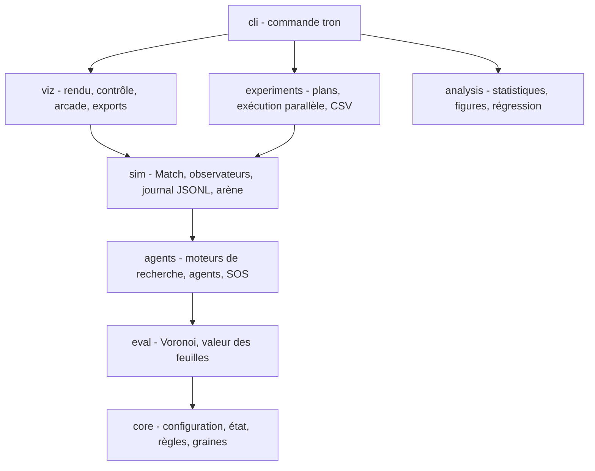
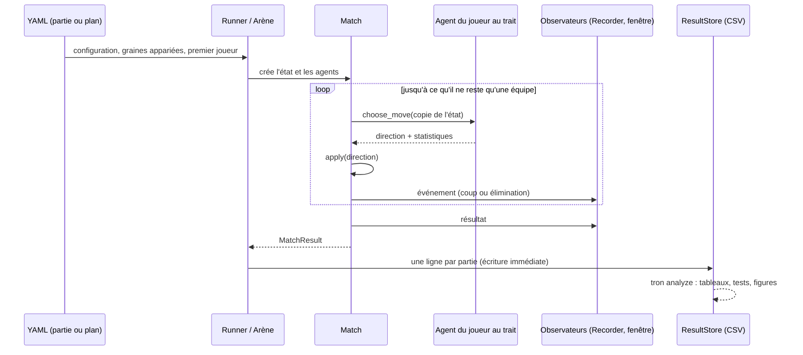

# Architecture

## Couches

Chaque couche est un paquet de `src/tron/` et ne dépend que des couches du dessous. Le cœur (`core`, `eval`, `agents`) ne connaît ni l'affichage ni les entrées-sorties : il s'exécute sans interface et se teste isolément. Les couleurs partagées par `viz` et `analysis` sont dans un module neutre (`tron/style.py`).

## Modules

| Paquet | Contenu |
|---|---|
| `core` | `GameConfig` (immuable, YAML), `GameState` (grille int8 à bordure sentinelle, `legal_moves`, `apply`, `undo`, `is_terminal`, `outcome`), placement initial, graines dérivées (`SeedSequence`), tables de Zobrist |
| `eval` | interface `Heuristic` et registre, `VoronoiHeuristic` (noyau BFS compatible Numba, tableaux préalloués), `Valuation` (codage commun des feuilles) |
| `agents` | interface `Agent` et registre, `RandomAgent`, `GreedyAgent`, `NegamaxAgent`, `ParanoidAgent`, `MaxNAgent`, `SocialAgent` ; moteurs `alphabeta`, `maxn`, `negamax` ; matrices W, réduction à deux camps, borne d'élagage généralisée |
| `sim` | `Match` (boucle, événements), `Recorder` (JSONL), `GameLog` (rejeu vérifié), `MatchResult`, `run_arena` |
| `experiments` | `Plan` (facteurs, plan complet ou partiel, graines appariées, rotation des sièges), scénarios des études A et B, `run_plan` (processus parallèles, reprise), `ResultStore` |
| `viz` | `Palette` (lisible par les daltoniens), `render_frame` (NumPy), `PlaybackController`, `LiveSource`, `ReplaySource`, exports GIF/MP4, `TronWindow` (arcade 3.3) |
| `analysis` | Wilson, agrégats, McNemar + Holm, figures matplotlib, régression logistique |
| `cli` | `tron play`, `replay`, `bench`, `run`, `analyze` |

## État et recherche

- **Grille** : tableau `int8` aplati de taille (H+2) × (W+2). La bordure vaut −2, une case libre −1 et un mur du joueur i vaut i ; la case (x, y) a l'indice (y+1)(W+2) + (x+1).
  Les déplacements sont des décalages constants (−(W+2), +1, +(W+2), −1). La bordure évite tout test de limite.
- **Vecteurs** : têtes (`int64`), joueurs vivants (`bool`), demi-coup d'élimination. Des vues `memoryview` donnent un accès scalaire rapide en Python, et les tableaux NumPy
  sont passés tels quels au noyau compilé.
- **apply / undo** : modification en place, historique, clé de Zobrist et compteurs d'équipes vivantes incrémentaux. Aucune copie d'état pendant la recherche.
- **Recherche** : parcours en profondeur à profondeur fixée, joueurs vivants en rotation. Aux feuilles (état terminal ou profondeur épuisée), le vecteur v est calculé par
  `Valuation`. Chaque joueur lance sa propre recherche à sa propre profondeur.
- **Patrons** :
  - stratégie : agents, heuristiques et scénarios interchangeables ;
  - observateur : événements de partie vers le journal et l'affichage ;
  - registre : instanciation par nom depuis la configuration.

## Flux de données

## Parallélisme et reproductibilité

- Chaque partie est une fonction pure de sa configuration et de sa graine, donc le résultat ne dépend pas de l'ordonnancement. Python 3.14 démarre les processus en `forkserver` sous Linux ; les tâches sont des objets sérialisables et la fonction de travail est définie au niveau du module.
- Le processus principal compile le noyau (cache Numba) avant de lancer les processus. Chaque processus le recharge dans son initialiseur, ce qui exclut la compilation des mesures de temps.
- Les lignes de résultats sont écrites et vidées au fil de l'eau. À la relance, une dernière ligne tronquée est réparée et les couples (condition, partie) déjà présents sont ignorés.
