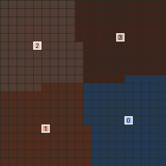
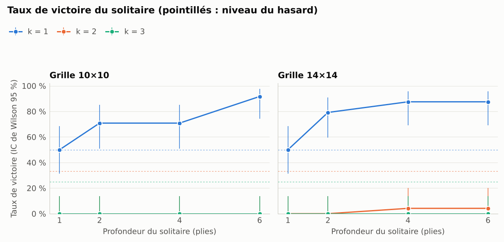
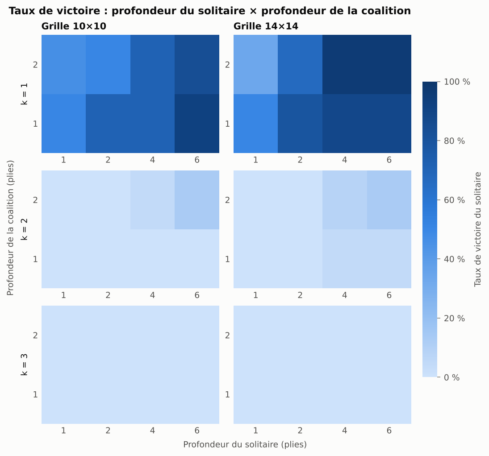
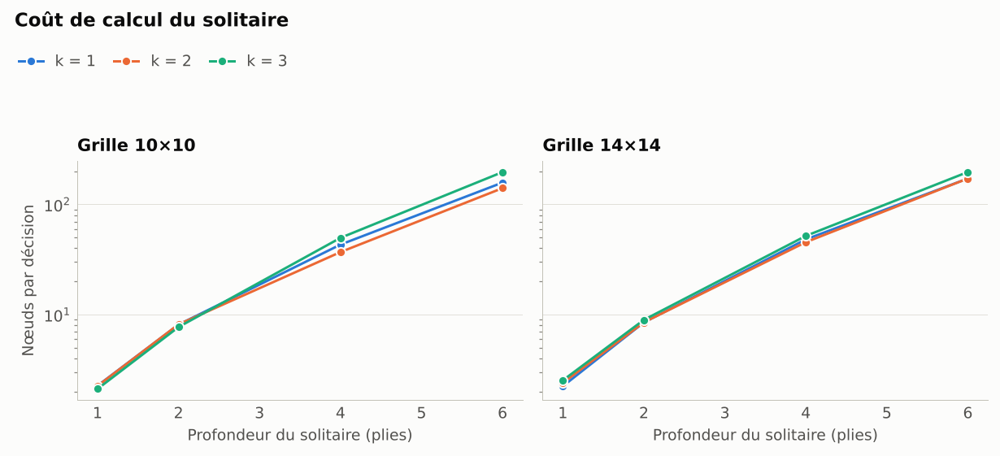

<div align="center">

# 🧪 Exemples produits par la chaîne complète

De la partie filmée aux tests statistiques : tout ce qui suit a été généré par le code du dépôt, **en Python pur (sans Numba), sans retouche**.

[⬅️ Retour au README principal](../../README.md) · [Mode d'emploi des campagnes](../experiences.md)

</div>

---

## 🎬 Une partie en GIF

<div align="center">
  
  <br>
  <sub>Un solitaire (bleu) contre une coalition de trois joueurs, avec les territoires de Voronoi.</sub>
</div>

```bash
tron play configs/games/solo_vs_3_20x20.yaml --no-gui --gif docs/exemples/solo_vs_3.gif --voronoi --cell 14 --fps 12
```

## 📊 Le plan pilote : 1 152 parties en une minute

Le pilote est une version réduite de l'**étude A** : un solitaire Paranoid contre une coalition coordonnée. Il a été exécuté en une minute sur deux cœurs.

```bash
tron run configs/plans/pilote.yaml --workers 2
tron analyze results/pilote/results.csv
```

| Facteur | Valeurs |
|---|---|
| profondeur du solitaire (Paranoid) | 1, 2, 4 ou 6 plis |
| coalition coordonnée (profil Équipe, α = 1) | profondeur 1 ou 2 |
| taille `k` de la coalition | 1 à 3 |
| grille | 10 × 10 et 14 × 14 |
| parties par condition | 24 |

> [!IMPORTANT]
> Ce plan sert à valider la chaîne et à calibrer la campagne. Ses effectifs sont trop faibles pour conclure : ce sont des indices, pas des résultats.

### 🏁 Qui gagne ?

<div align="center">
  
</div>

Un solitaire qui réfléchit plus profondément gagne davantage… tant que la coalition reste petite. Dès `k = 2`, il ne gagne presque plus jamais, et il n'a gagné aucune des 384 parties jouées à `k = 3`. Les pointillés marquent le niveau du hasard.

### 🔥 Profondeur contre nombre

<div align="center">
  
</div>

Chaque case croise la profondeur du solitaire (en abscisse) et celle de la coalition (en ordonnée). La rangée `k = 1` est la seule vraiment colorée : c'est là que la profondeur fait la différence.

### ⏱️ Combien ça coûte ?

<div align="center">
  
</div>

L'échelle est logarithmique : chaque pli supplémentaire multiplie le travail par au plus 3 environ.

## 🔍 Ce que l'on y lit déjà

- **Des gains décroissants de la profondeur en duel.** Le solitaire y gagne 43, 64, 78 puis 86 parties sur 96 aux profondeurs 1, 2, 4 et 6. Les comparaisons appariées (288 paires, McNemar avec correction de Holm, `pilote_paired.csv`) sont significatives de 1 à 2 plis (p = 0,002) et de 2 à 4 plis (p = 0,006), mais pas de 4 à 6 (p = 0,08).
- **Une coalition coordonnée de deux joueurs ou plus l'emporte presque toujours** sur ces petites grilles.
- **Un coût de calcul multiplié par environ 3 à chaque pli supplémentaire, au plus.**

## 🗂️ Contenu du dossier

| Fichier | Contenu |
|---|---|
| `solo_vs_3.gif` | la partie animée ci-dessus |
| `pilote_taux_victoire.png` | taux de victoire du solitaire, intervalles de Wilson à 95 % |
| `pilote_cartes_de_chaleur.png` | taux de victoire selon les deux profondeurs, par `k` et par grille |
| `pilote_cout.png` | nœuds explorés par décision |
| `pilote_summary.csv` | une ligne par condition : parties, victoires, intervalle de Wilson, rang moyen, durée, nœuds et temps par décision |
| `pilote_paired.csv` | comparaisons appariées entre profondeurs (McNemar, correction de Holm) |
| `pilote_regression.txt` | régression logistique de la victoire du solitaire |

> [!TIP]
> Envie de faire mieux ? `tron run configs/plans/etude_a.yaml --workers 8` lance la version complète de cette étude (360 conditions), avec reprise automatique si vous l'interrompez.
